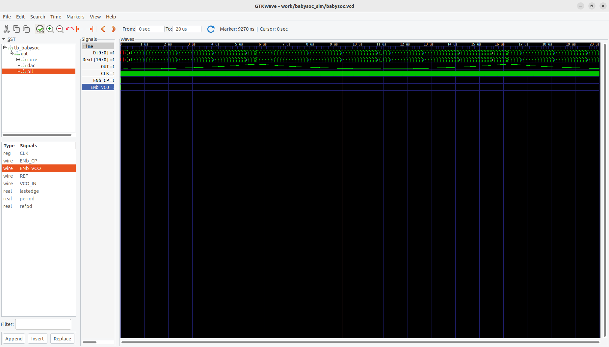
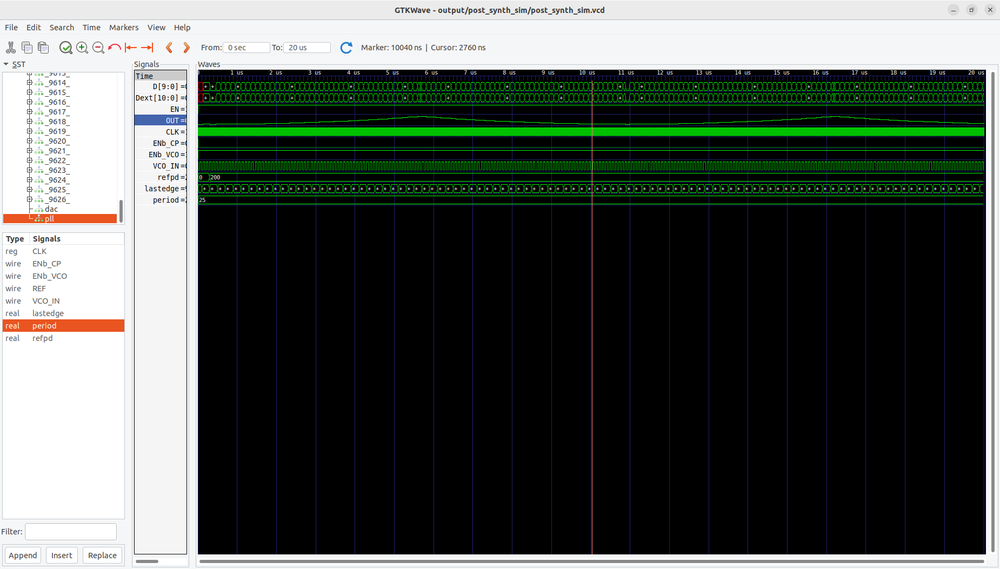

# Week 3 — VSDBabySoC Synthesis and Post-Synthesis Simulation

> **Scope:** Reproducible steps that actually led to the successful Yosys synthesis and matching *initial* RTL/gate-level RVMyth + PLL + DAC output in the Ubuntu 22.04 VM. This is an execution record, not a verification checklist. Failed attempts are omitted; the specific corrections that made the flow work are retained. Full-run log equivalence was not established in the recorded session.

## Step 1 — Reference repositories and source files

The working directory was `~/VSDBabySoC`. The following reference repositories were associated with the design:

| Reference | URL | Role |
|---|---|---|
| Week 3 / Task 12 write-up | https://github.com/hemanthkumardm/SFAL-VSD-SoC-Journey/tree/main/12.%20VSDBabySoC%20Project | Target pre-/post-synthesis results and command structure |
| Original BabySoC project | https://github.com/manili/VSDBabySoC | Top-level RTL and synthesis flow reference |
| RVMyth core | https://github.com/kunalg123/rvmyth | Processor design reference |
| PLL IP | https://github.com/lakshmi-sathi/avsdpll_1v8 | PLL reference |
| DAC interface | https://github.com/vsdip/rvmyth_avsddac_interface | DAC and interface reference |

**Provenance note:** These are upstream references, **not a log of downloads performed during this session**. All source files and Liberty/SKY130 files listed below were **already present locally** when the synthesis work began. The earlier clone/download commands and exact commit revisions were not recorded, so they are not invented here. The Week 3 GitHub folder itself contains a README describing the flow; its contents were not used as a direct local RTL download.

Existing local inputs:

```text
~/VSDBabySoC/
├── src/
│   ├── module/
│   │   ├── vsdbabysoc.v       # existing synth top
│   │   ├── rvmyth.v           # generated from TL-Verilog previously
│   │   ├── rvmyth_gen.v       # included by rvmyth.v
│   │   ├── clk_gate.v
│   │   ├── avsdpll.v
│   │   └── avsddac.v
│   ├── include/              # existing SandPiper/RTL includes
│   ├── script/yosys.ys       # original Yosys script
│   ├── lib/
│   │   ├── avsdpll.lib
│   │   ├── avsddac.lib
│   │   └── sky130_fd_sc_hd__tt_025C_1v80.lib
│   └── gls_model/
│       ├── primitives.v
│       └── sky130_fd_sc_hd.v
└── work/babysoc_sim/        # working pre-synthesis simulation from earlier work
```

The local software used was Yosys (`0.69+158`), Icarus Verilog (`11.0`), and GTKWave. These tools were already installed; installation is not part of this record.

## Step 2 — Prepare the generated RVMyth RTL for Yosys

Run from the project root:

```bash
cd ~/VSDBabySoC
mkdir -p output/compiled_tlv output/synth output/post_synth_sim

sed '/^[[:space:]]*`line[[:space:]]/d' \
  src/module/rvmyth.v \
  > output/compiled_tlv/rvmyth.v
```

**File created:** `output/compiled_tlv/rvmyth.v` (approximately 16 KB). Its existing `` `include "rvmyth_gen.v" `` still resolves to `src/module/rvmyth_gen.v` through an explicit include path.

**Correction and cause:** The first attempt to copy `/tmp/rvmyth_noline.v` failed with `cp: cannot stat ... No such file or directory`, because the temporary source no longer existed. The successful correction was to recreate the sanitized RTL directly from `src/module/rvmyth.v` using `sed`. The removal of generated `` `line `` directives also preserved the earlier Icarus-compatible RTL behavior without editing the original.

## Step 3 — Copy and correct the Yosys synthesis script

```bash
cd ~/VSDBabySoC
cp src/script/yosys.ys src/script/yosys_week3.ys
gedit src/script/yosys_week3.ys &
```

**Only one source-reading command was changed** in this working copy:

```tcl
# Original:
read_verilog -I./include ../output/compiled_tlv/rvmyth.v

# Replacement:
read_verilog -sv -I./include -I./module ../output/compiled_tlv/rvmyth.v
```

**Correction and cause:** SandPiper-generated RVMyth uses SystemVerilog constructs and the `rvmyth_gen.v` include. `-sv` enables parsing them; `-I./module` allows the include to resolve. The original `src/script/yosys.ys` was not overwritten.

The rest of the original script was retained, including these synthesis stages:

```tcl
read_verilog ./module/vsdbabysoc.v
read_verilog -sv -I./include -I./module ../output/compiled_tlv/rvmyth.v
read_verilog -I./include ./module/clk_gate.v
read_liberty -lib ./lib/avsdpll.lib
read_liberty -lib ./lib/avsddac.lib
read_liberty -lib ./lib/sky130_fd_sc_hd__tt_025C_1v80.lib
synth -top vsdbabysoc
dfflibmap -liberty ./lib/sky130_fd_sc_hd__tt_025C_1v80.lib
opt
abc -liberty ./lib/sky130_fd_sc_hd__tt_025C_1v80.lib -script +strash;scorr;ifraig;retime;{D};strash;dch,-f;map,-M,1,{D}
flatten
setundef -zero
clean -purge
rename -enumerate
stat
write_verilog -noattr ../output/synth/vsdbabysoc.synth.v
```

The analog PLL and DAC were read through Liberty as **black-box cells** for digital synthesis; their real-valued behavioral models were later supplied only for simulation.

## Step 4 — Run Yosys and generate the SKY130 netlist

**Important:** Run Yosys from `src/` because the `.ys` file uses paths relative to that directory.

```bash
cd ~/VSDBabySoC/src
yosys -s script/yosys_week3.ys \
  -l ../output/synth/yosys_week3.log
```

**Files created:**

```text
output/synth/yosys_week3.log
output/synth/vsdbabysoc.synth.v
```

**Observed successful synthesis result:** The netlist was approximately **685 KB**, with a flattened `vsdbabysoc` top containing **5,452 cells**, including **1,140 `sky130_fd_sc_hd__dfxtp_1` flip-flops**, one `avsdpll`, and one `avsddac` instance. Yosys reached `write_verilog`, reported six warnings and ended its script. The original netlist retained one-bit `OUT` and `VREFH` ports, as is expected from the source used for digital synthesis.

## Step 5 — Prepare a simulation-only SKY130 cell library

The pre-existing standard-cell Verilog simulation file contained an invalid generated declaration at the recorded line 67667:

```verilog
wire 1;
```

That caused Icarus to stop with `syntax error` and `invalid module item` at that line. To correct it without touching the original PDK file:

```bash
cd ~/VSDBabySoC
cp src/gls_model/sky130_fd_sc_hd.v \
  output/post_synth_sim/sky130_fd_sc_hd_fixed.v

sed -i '67667d' \
  output/post_synth_sim/sky130_fd_sc_hd_fixed.v
```

**File created:** `output/post_synth_sim/sky130_fd_sc_hd_fixed.v`.

**Correction and cause:** Deleting the malformed `wire 1;` line from the copy resolved the Icarus syntax failure. This was a narrowly targeted repair to the model file used in this run, **not** a general-purpose upstream PDK fix.

## Step 6 — Adapt the synthesized netlist for the real-valued DAC simulation

The Yosys netlist legally represented `OUT` and `VREFH` as ordinary one-bit ports because the original synthesizable top declared them that way. However, our successful RTL simulation had used real-valued DAC reference/output signals and both reference voltages. To expose equivalent DAC voltages after synthesis, we produced a **simulation-only copy**, without changing any mapped SKY130 logic:

```bash
cd ~/VSDBabySoC
python3 - <<'PY'
from pathlib import Path

src = Path("output/synth/vsdbabysoc.synth.v")
dst = Path("output/post_synth_sim/vsdbabysoc_gls.sv")
s = src.read_text()

changes = [
    (
        "module vsdbabysoc(OUT, reset, VCO_IN, ENb_CP, ENb_VCO, REF, VREFH);",
        "module vsdbabysoc_sim(OUT, reset, VCO_IN, ENb_CP, ENb_VCO, REF, VREFL, VREFH);"
    ),
    (
        "  output OUT;\n  wire OUT;",
        "  output wire real OUT;"
    ),
    (
        "  input VREFH;\n  wire VREFH;",
        "  input wire real VREFL;\n  input wire real VREFH;"
    ),
    (
        "    .VREFH(VREFH)\n  );",
        "    .VREFH(VREFH),\n    .VREFL(VREFL)\n  );"
    )
]

for old, new in changes:
    count = s.count(old)
    if count != 1:
        raise RuntimeError(f"Expected one occurrence, found {count}: {old[:60]}")
    s = s.replace(old, new, 1)

dst.write_text("`timescale 1ns/1ps\n" + s)
print("Simulation netlist created:", dst)
PY
```

**File created:** `output/post_synth_sim/vsdbabysoc_gls.sv`.

**Correction and cause:** This preserves the synthesized processor's digital gates while changing only the outer simulation interface to `output wire real OUT`, `input wire real VREFH`, and `input wire real VREFL`, and wiring `.VREFL(VREFL)` to the DAC. Renaming the top to `vsdbabysoc_sim` allowed reuse of the already working `tb_babysoc` testbench. **This adapted file is for simulation only, not a production netlist for physical design.**

## Step 7 — Preserve the pre-synthesis testbench and redirect the post-synthesis VCD

The pre-existing functional simulation inputs were:

```text
work/babysoc_sim/avsdpll_sim.v     # simulation copy of PLL with `timescale 1ns/1ps
work/babysoc_sim/tb_babysoc.sv     # previously working reset/PLL/DAC stimulus
src/module/avsddac.v              # existing DAC model
```

The PLL simulation copy had been produced earlier by prepending the timescale directive to `src/module/avsdpll.v`:

```bash
cd ~/VSDBabySoC
sed '1i`timescale 1ns/1ps' src/module/avsdpll.v \
  > work/babysoc_sim/avsdpll_sim.v
```

**Correction and cause:** Without an explicit timescale, the model's `#(period / 2.0)` delay was interpreted incorrectly and no PLL/DAC sample messages appeared within the simulation window. Adding the timescale gave the observed 25 ns PLL clock period. The testbench also used a **100 ns active-high reset** (the earlier 20 ns reset caused unknown RVMyth values), `VREFL = 0.0`, and `VREFH = 3.3`.

To avoid overwriting the working pre-synthesis waveform, a separate testbench was created:

```bash
cp work/babysoc_sim/tb_babysoc.sv \
  output/post_synth_sim/tb_babysoc_post.sv

sed -i \
  's|work/babysoc_sim/babysoc.vcd|output/post_synth_sim/post_synth_sim.vcd|' \
  output/post_synth_sim/tb_babysoc_post.sv
```

**File created:** `output/post_synth_sim/tb_babysoc_post.sv`.

## Step 8 — Compile the gate-level design with functional SKY130 models

**Critical correction:** The first gate-level simulation compiled without `-DFUNCTIONAL` but returned `DAC_CODE=x` and `DAC_OUT=0.000000 V` throughout. In the selected non-functional cell-model branch, the flip-flop UDP was connected to `D_delayed` and `CLK_delayed`, which were not driven in the compilation configuration. Compiling with `-DFUNCTIONAL` selected the functional cell models and resolved the unknown-output failure.

The successful command was:

```bash
cd ~/VSDBabySoC
iverilog -g2012 -DFUNCTIONAL \
  -I src/gls_model \
  -I src/module \
  -I src/include \
  -s tb_babysoc \
  -o output/post_synth_sim/post_synth_sim.vvp \
  output/post_synth_sim/vsdbabysoc_gls.sv \
  work/babysoc_sim/avsdpll_sim.v \
  src/module/avsddac.v \
  src/gls_model/primitives.v \
  output/post_synth_sim/sky130_fd_sc_hd_fixed.v \
  output/post_synth_sim/tb_babysoc_post.sv
```

**File created:** `output/post_synth_sim/post_synth_sim.vvp` (roughly 14 MB in the earlier compilation).

The successful build still emitted `macro UNIT_DELAY undefined (and assumed null)` warnings. They **did not stop compilation or prevent the matching initial functional output**. An explicit `UNIT_DELAY` definition was discussed but **was not used in the recorded successful command**, so it is not included as an executed correction.

## Step 9 — Run the successful post-synthesis simulation

```bash
cd ~/VSDBabySoC
vvp output/post_synth_sim/post_synth_sim.vvp \
  > output/post_synth_sim/simulation.log
```

**Files generated:**

```text
output/post_synth_sim/simulation.log
output/post_synth_sim/post_synth_sim.vcd
```

The initial sequence in the post-synthesis output matched the previously recorded pre-synthesis sequence (same sampled timestamps, digital codes, and DAC values):

```text
Time=150000 CLK=0 DAC_CODE=  17 DAC_OUT=0.054839 V
Time=325000 CLK=0 DAC_CODE=   0 DAC_OUT=0.000000 V
Time=475000 CLK=0 DAC_CODE=   1 DAC_OUT=0.003226 V
Time=600000 CLK=0 DAC_CODE=   3 DAC_OUT=0.009677 V
Time=725000 CLK=0 DAC_CODE=   6 DAC_OUT=0.019355 V
```

These `Time` values are in **picoseconds** in the `%0t` log display, e.g. `150000` corresponds to **150 ns** for the `1ns/1ps` testbench timescale. They are recorded samples, not a claim of exhaustive log equivalence.

The VCD file can be opened in GTKWave using:

```bash
gtkwave output/post_synth_sim/post_synth_sim.vcd
```
### Pre-Synthesis Simulation Waveform

The following screenshot shows the VSDBabySoC pre-synthesis simulation, including the PLL clock, RVMyth digital output, and DAC analog output.



### Post-Synthesis Simulation Waveform

The following screenshot shows the corresponding post-synthesis simulation after Yosys synthesis and SKY130 technology mapping.


## Files actually created or modified during this synthesis/post-synthesis work

| File | Action | Reason |
|---|---|---|
| `output/compiled_tlv/rvmyth.v` | Created from existing `src/module/rvmyth.v` | Removed source-location directives; replaced missing `/tmp` copy |
| `src/script/yosys_week3.ys` | Copied from original and edited one `read_verilog` line | Enabled SystemVerilog and module include lookup |
| `output/synth/yosys_week3.log` | Generated by Yosys | Captured synthesis run |
| `output/synth/vsdbabysoc.synth.v` | Generated by Yosys | SKY130-mapped gate-level design |
| `output/post_synth_sim/sky130_fd_sc_hd_fixed.v` | Copied from existing SKY130 model; removed invalid `wire 1;` | Fixed Icarus parsing error |
| `output/post_synth_sim/vsdbabysoc_gls.sv` | Generated from Yosys netlist | Exposed real-valued DAC ports for matching simulation |
| `output/post_synth_sim/tb_babysoc_post.sv` | Copied from working pre-synthesis testbench; changed `$dumpfile` path | Prevented pre-synthesis waveform overwrite |
| `output/post_synth_sim/post_synth_sim.vvp` | Generated by Icarus | Functional gate-level simulation executable |
| `output/post_synth_sim/simulation.log` | Generated by `vvp` | Recorded post-synthesis samples |
| `output/post_synth_sim/post_synth_sim.vcd` | Generated by `vvp` | GTKWave post-synthesis waveform |
| `work/babysoc_sim/avsdpll_sim.v` | Previously created from local PLL with timescale prepended | Correct PLL delay units for simulation |

**Unchanged original files:** `src/module/vsdbabysoc.v`, `src/module/rvmyth.v`, `src/module/rvmyth_gen.v`, `src/module/clk_gate.v`, `src/module/avsdpll.v`, `src/module/avsddac.v`, `src/script/yosys.ys`, the `.lib` files, `src/gls_model/primitives.v`, and `src/gls_model/sky130_fd_sc_hd.v`.

**Outcome:** Successful Yosys SKY130 synthesis and successful functional gate-level simulation; the recorded initial digital and DAC samples matched the earlier pre-synthesis run. Timing-aware GLS, complete formal equivalence, STA, and physical implementation were **not** part of this work record.
