# Week 4 — BabySoC OpenSTA PVT Timing Analysis

## 1. Objective

The objective of Week 4 is to perform post-synthesis Static Timing Analysis (STA) of the VSDBabySoC design using OpenSTA and SKY130 standard-cell libraries.

The analysis includes:

- Setup timing analysis
- Hold timing analysis
- Worst Negative Slack (WNS)
- Total Negative Slack (TNS)
- Timing analysis across 16 Process, Voltage, and Temperature (PVT) corners
- Consolidation of timing results into CSV format
- Generation of seven bar graphs and seven line graphs

The gate-level simulation was completed during Week 3. Week 4 reuses the synthesized BabySoC netlist.

## 2. Development Environment

| Component | Description |
|---|---|
| Operating System | Ubuntu 22.04 |
| Design | VSDBabySoC |
| Processor | RVMyth RISC-V CPU |
| Technology | SKY130 HD |
| Synthesis Tool | Yosys |
| Static Timing Analysis | OpenSTA 3.1.0 |
| Programming Language | Python 3 |
| Plotting Library | Matplotlib |
| Clock Frequency | 40 MHz |
| Clock Period | 25 ns |
| Number of PVT Corners | 16 |

## 3. Input Files

The following files were used from the VSDBabySoC project:

- `output/synth/vsdbabysoc.synth.v`
- `src/lib/sky130_fd_sc_hd__tt_025C_1v80.lib`
- `src/lib/avsdpll.lib`
- `src/lib/avsddac.lib`

Additional SKY130 PVT Liberty libraries were obtained from the locally installed SKY130A PDK.

The original synthesized netlist and complete SKY130 PDK are not duplicated in this GitHub submission.

A cleaned PLL Liberty model is provided in:

`lib/avsdpll_sta.lib`

## 4. OpenSTA Configuration

OpenSTA 3.1.0 was used to perform static timing analysis on the synthesized VSDBabySoC netlist.

Two Tcl scripts were developed:

1. `babysoc_sta.tcl` — Performs initial timing analysis using the typical SKY130 corner.
2. `babysoc_pvt_sta.tcl` — Performs timing analysis across the 16 SKY130 PVT corners.

The scripts are available here:

- [Typical-Corner OpenSTA Script](scripts/babysoc_sta.tcl)
- [Multi-Corner PVT Analysis Script](scripts/babysoc_pvt_sta.tcl)

### 4.1 Timing Constraints

The SDC file is available here:

[BabySoC SDC Timing Constraints](constraints/babysoc.sdc)

The following timing constraints were applied:

| Parameter | Value |
|---|---|
| Clock source | `pll/CLK` |
| Clock period | 25 ns |
| Nominal clock frequency | 40 MHz |
| Clock uncertainty | 0.5 ns |
| Clock transition | 0.1 ns |
| Reset maximum input delay | 1.0 ns |
| Reset minimum input delay | 0.0 ns |

### 4.2 Clock Definition

The clock was defined at the output of the PLL using:

```tcl
create_clock -name pll_clk -period 25.0 [get_pins pll/CLK]
```

Clock uncertainty and transition were configured as follows:

```tcl
set_clock_uncertainty 0.5 [get_clocks pll_clk]
set_clock_transition 0.1 [get_clocks pll_clk]
```

### 4.3 Reset Timing Constraints

Input timing constraints were applied to the reset signal:

```tcl
set_input_delay -clock pll_clk -max 1.0 [get_ports reset]
set_input_delay -clock pll_clk -min 0.0 [get_ports reset]
```

These values are preliminary timing assumptions used for this exercise.

### 4.4 DAC Output Timing

The DAC output was excluded from digital timing analysis:

```tcl
set_false_path -to [get_ports OUT]
```

This exception was introduced because the available DAC Liberty model does not contain the required timing arcs for complete digital-to-analog output timing analysis.

### 4.5 Liberty Library Preparation

The original PLL Liberty model contained comments that caused parsing errors in OpenSTA.

A cleaned copy of the PLL Liberty file was created:

`lib/avsdpll_sta.lib`

The original source Liberty file was preserved.

The SKY130 standard-cell timing libraries were obtained from the installed SKY130A PDK.

### 4.6 Running Typical-Corner Analysis

From the VSDBabySoC project root:

```bash
sta -exit work/week4_opensta/scripts/babysoc_sta.tcl
```

This generates timing reports for the typical SKY130 process corner:

`tt_025C_1v80`

The analysis includes setup timing, hold timing, slack, WNS, and TNS.

## 5. Typical-Corner Timing Analysis Results

The following results were obtained for the typical SKY130 corner.

| Timing Parameter | Result |
|---|---:|
| Worst setup slack | +13.23 ns |
| Worst overall hold slack | -0.49 ns |
| Worst internal hold slack | Approximately -0.167 ns |
| Setup WNS | 0.00 ns |
| Setup TNS | 0.00 ns |
| Hold WNS | -0.49 ns |
| Hold TNS | -45.19 ns |

### 5.1 Setup Timing

The worst setup slack was:

**+13.23 ns**

This indicates that the analyzed setup paths meet the assumed 25 ns clock requirement at the typical corner.

### 5.2 Hold Timing

The overall worst hold slack was:

**-0.49 ns**

The worst internal register-to-register hold slack was approximately:

**-0.167 ns**

The analysis therefore identified hold-timing violations.

Some hold violations involve the externally constrained reset signal. Their interpretation depends on the assumed reset-input timing.

### 5.3 Timing Analysis Observations

- Setup timing passed at the typical corner.
- Hold-timing violations were observed.
- Timing analysis was performed on the post-synthesis netlist.
- Routing parasitics were not included.
- The clock network was modeled as ideal.
- Timing closure cannot be established from these results alone.

## 6. Multi-Corner PVT Timing Analysis

### 6.1 Objective

To evaluate the timing behavior of VSDBabySoC under different Process, Voltage, and Temperature (PVT) conditions, static timing analysis was performed using 16 SKY130 standard-cell Liberty corners.

The analysis included:

- 2 Typical-Typical (TT) corners
- 6 Fast-Fast (FF) corners
- 8 Slow-Slow (SS) corners

Each PVT corner was analyzed independently using OpenSTA 3.1.0.

### 6.2 PVT Analysis Script

The Tcl script used for the analysis is available here:

[BabySoC PVT OpenSTA Script](scripts/babysoc_pvt_sta.tcl)

The script selects the Liberty library using the `PVT_CORNER` environment variable.

Example:

```bash
cd ~/VSDBabySoC

PVT_CORNER=tt_025C_1v80 \
sta -exit work/week4_opensta/scripts/babysoc_pvt_sta.tcl
```

This executes OpenSTA for the selected timing corner.

The resulting timing reports are saved under:

`work/week4_opensta/reports/pvt/<corner_name>/`

All 16 PVT corners were analyzed successfully.

### 6.3 PVT Timing Results

The following table summarizes the measured setup slack, overall hold slack, internal hold slack, and hold TNS.

| PVT Corner | Setup Slack (ns) | Overall Hold Slack (ns) | Internal Hold Slack (ns) | Hold TNS (ns) |
|---|---:|---:|---:|---:|
| ff_100C_1v65 | +15.62 | -0.49 | -0.2287 | -128.89 |
| ff_100C_1v95 | +17.10 | -0.49 | -0.2822 | -211.20 |
| ff_n40C_1v56 | +13.27 | -0.49 | -0.1850 | -67.03 |
| ff_n40C_1v65 | +15.10 | -0.49 | -0.2200 | -116.90 |
| ff_n40C_1v76 | +16.07 | -0.49 | -0.2500 | -163.72 |
| ff_n40C_1v95 | +17.19 | -0.49 | -0.2870 | -221.60 |
| ss_100C_1v40 | -10.33 | -0.43 | +0.4290 | -0.43 |
| ss_100C_1v60 | +1.63 | -0.45 | +0.1640 | -0.45 |
| ss_n40C_1v28 | -94.95 | -0.45 | +1.3460 | -0.45 |
| ss_n40C_1v35 | -51.72 | -0.45 | +0.8690 | -0.45 |
| ss_n40C_1v40 | -35.02 | -0.46 | +0.6460 | -0.46 |
| ss_n40C_1v44 | -27.26 | -0.46 | +0.5120 | -0.46 |
| ss_n40C_1v60 | -5.15 | -0.47 | +0.1860 | -0.47 |
| ss_n40C_1v76 | +3.17 | -0.48 | +0.0170 | -0.48 |
| tt_025C_1v80 | +13.23 | -0.49 | -0.1670 | -45.19 |
| tt_100C_1v80 | +13.68 | -0.48 | -0.1650 | -41.28 |

The complete timing results, including setup WNS, setup TNS, hold WNS, and hold TNS, are available in the consolidated CSV file:

[BabySoC PVT Timing Summary CSV](csv/babysoc_pvt_timing_summary.csv)

### 6.4 Worst Setup Timing Corner

The worst setup timing was observed at:

**PVT Corner:** `ss_n40C_1v28`

**Worst Setup Slack:** `-94.95 ns`

This represents the most severe setup violation among the 16 analyzed corners.

Six slow-process corners exhibited negative setup slack:

1. `ss_100C_1v40`
2. `ss_n40C_1v28`
3. `ss_n40C_1v35`
4. `ss_n40C_1v40`
5. `ss_n40C_1v44`
6. `ss_n40C_1v60`

These results indicate that the assumed 25 ns clock period is insufficient for the analyzed paths at these corners.

### 6.5 Worst Hold Timing Corner

The worst internal register-to-register hold slack was observed at:

**PVT Corner:** `ff_n40C_1v95`

**Internal Hold Slack:** `-0.287 ns`

This is consistent with the increased risk of hold violations under fast-process conditions.

The worst cumulative hold violation was also observed at this corner:

**Hold TNS:** `-221.60 ns`

Hold Total Negative Slack represents the sum of negative hold slack across violating endpoints.

### 6.6 Overall Hold Timing

The overall hold slack remains negative across all 16 analyzed corners.

This result is influenced by the reset input timing assumptions and the internal register-to-register hold paths.

The overall hold slack and internal hold slack are reported separately to distinguish input-related violations from internal timing behavior.

### 6.7 Interpretation of PVT Results

The analysis demonstrates the effect of process, voltage, and temperature on the synthesized BabySoC timing paths.

Key observations:

- Fast-process corners generally provide better setup timing.
- Slow-process corners produce the most severe setup violations.
- Fast-process corners exhibit more significant internal hold violations.
- The worst setup and hold conditions occur at different PVT corners.
- The 25 ns clock constraint is not satisfied across all 16 corners.

These are post-synthesis timing estimates. Routing parasitics, clock-tree delays, and complete external interface constraints are not included.

Therefore, the results should not be interpreted as post-route timing sign-off.

## 7. PVT Timing Analysis — Bar Graphs

Seven bar graphs were generated to compare the timing characteristics of VSDBabySoC across all 16 PVT corners.

### 7.1 Setup Slack

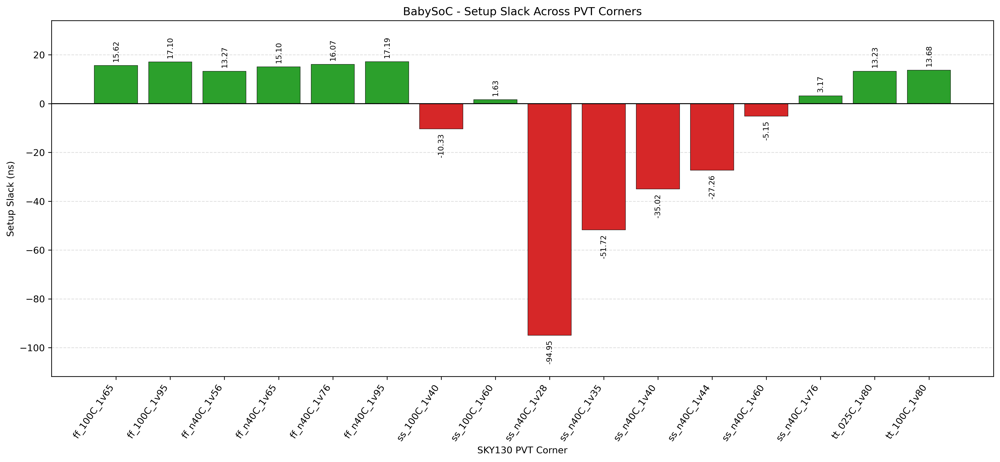

### 7.2 Overall Hold Slack

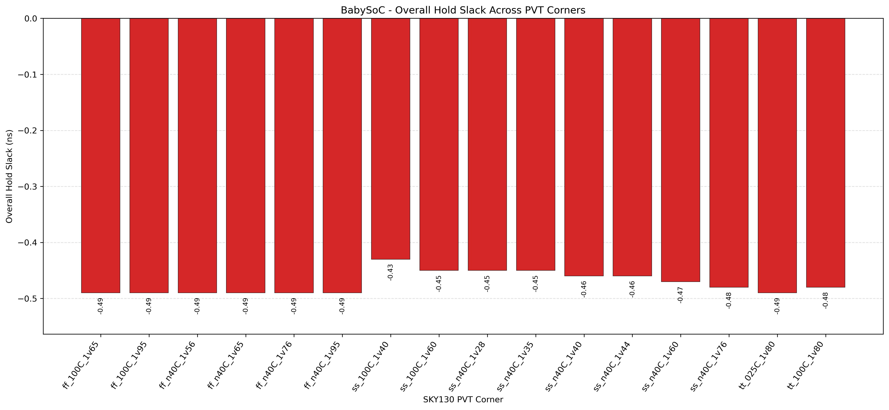

### 7.3 Internal Hold Slack

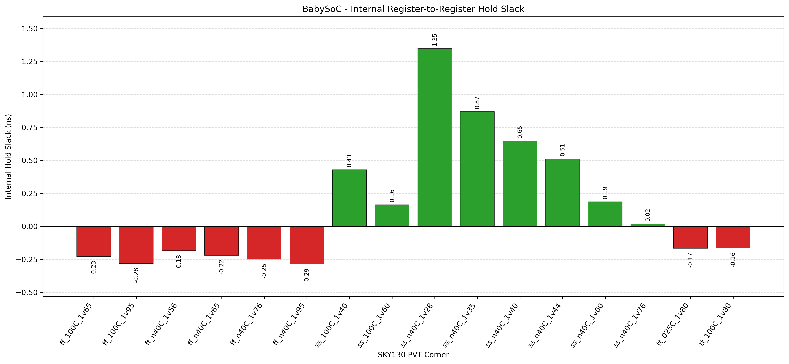

### 7.4 Setup Worst Negative Slack (WNS)

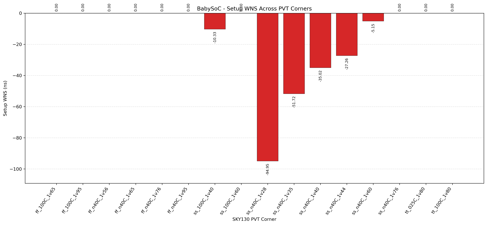

### 7.5 Setup Total Negative Slack (TNS)

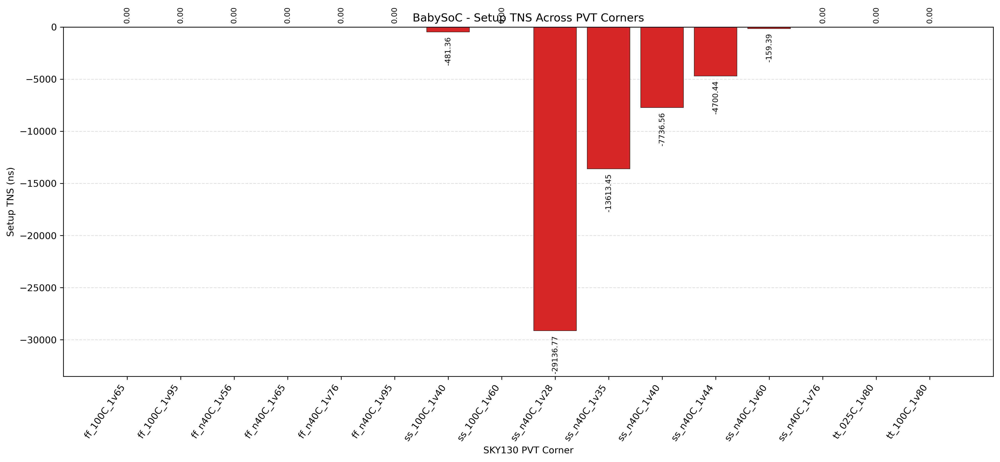

### 7.6 Hold Worst Negative Slack (WNS)

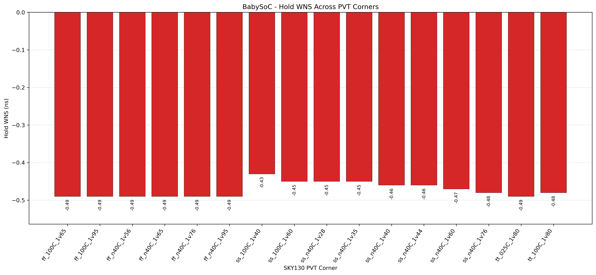

### 7.7 Hold Total Negative Slack (TNS)

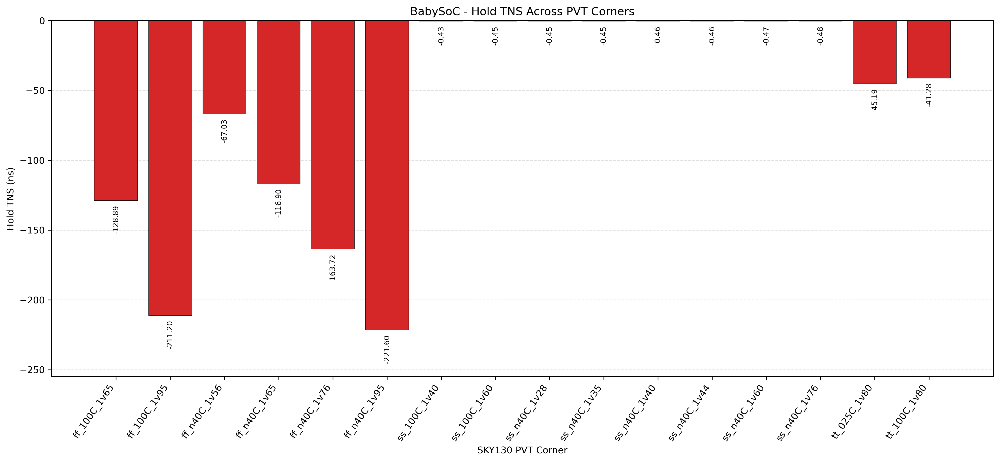

## 8. PVT Timing Analysis — Line Graphs

Seven line graphs were generated to visualize the variation in setup and hold timing parameters across the 16 PVT corners.

### 8.1 Setup Slack

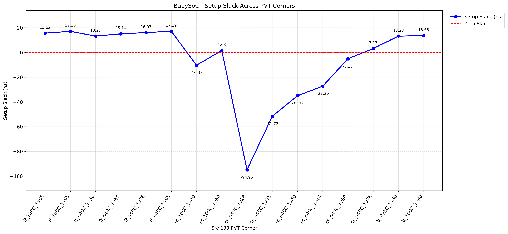

### 8.2 Overall Hold Slack

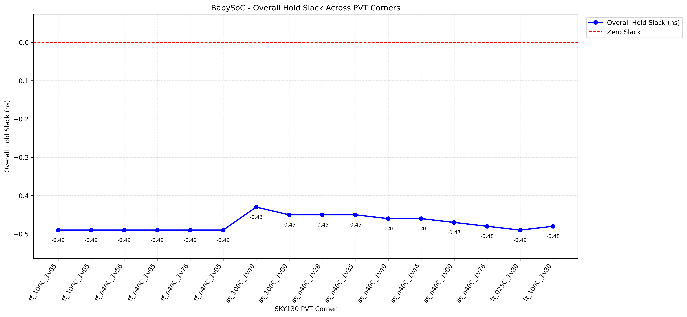

### 8.3 Internal Hold Slack

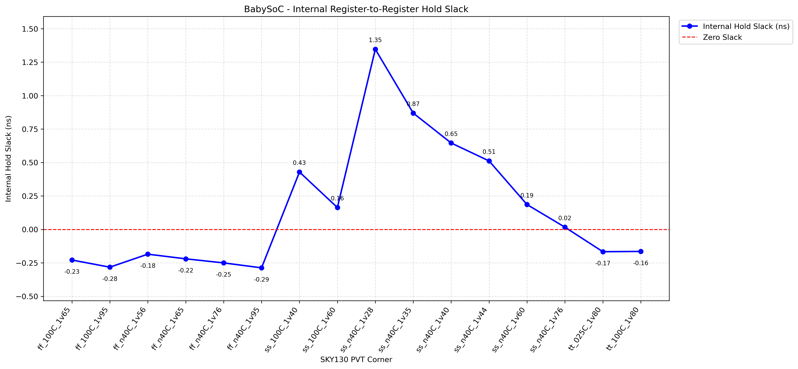

### 8.4 Setup Worst Negative Slack (WNS)

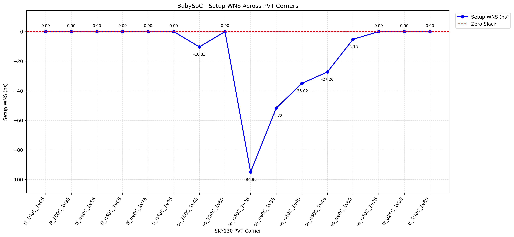

### 8.5 Setup Total Negative Slack (TNS)

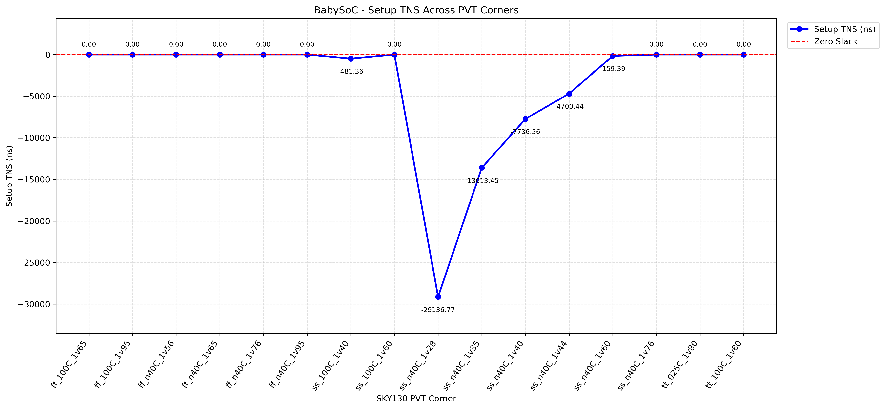

### 8.6 Hold Worst Negative Slack (WNS)

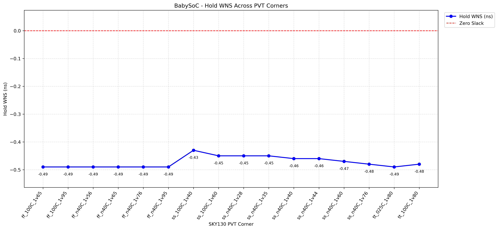

### 8.7 Hold Total Negative Slack (TNS)

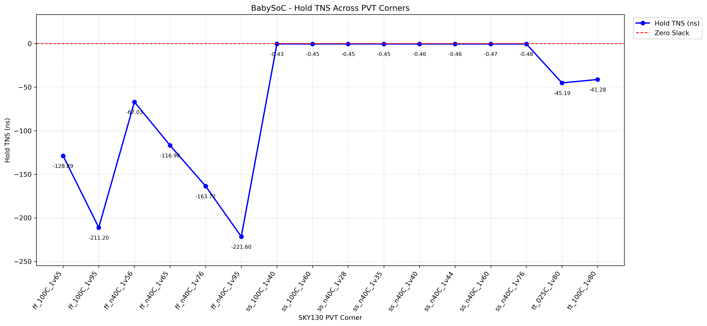

### 8.8 Graph Interpretation

The graphs demonstrate how setup and hold timing vary across process, voltage, and temperature conditions.

Key observations:

- Slow-process corners exhibit the largest setup-timing degradation.
- Fast-process corners generally exhibit improved setup timing.
- Internal hold violations are more severe at fast-process corners.
- The worst setup and hold conditions occur at different PVT corners.
- The zero-slack reference line distinguishes timing violations from passing results.
- PVT corners represent discrete operating conditions. Connecting points in the line graphs is for visualization and does not imply interpolation between characterized conditions.

Both bar graphs and line graphs have been preserved to provide complementary visual representations of the timing results.

## 9. Python Automation Scripts

Python scripts were developed to extract OpenSTA timing results and generate graphical comparisons across the 16 PVT corners.

The following scripts are included in this repository:

| Script | Purpose |
|---|---|
| [extract_pvt_results.py](scripts/extract_pvt_results.py) | Extracts timing metrics from OpenSTA reports and generates the consolidated CSV |
| [plot_pvt_timing_bars.py](scripts/plot_pvt_timing_bars.py) | Generates seven bar graphs |
| [plot_pvt_timing_lines.py](scripts/plot_pvt_timing_lines.py) | Generates seven line graphs |
| [plot_pvt_timing.py](scripts/plot_pvt_timing.py) | Original timing visualization script |

### 9.1 Consolidated Timing Results

The Python extraction script produces:

[BabySoC PVT Timing Summary](csv/babysoc_pvt_timing_summary.csv)

The CSV includes the following 11 columns:

1. PVT Corner
2. Process
3. Temperature (C)
4. Voltage (V)
5. Setup Slack (ns)
6. Overall Hold Slack (ns)
7. Internal Hold Slack (ns)
8. Setup WNS (ns)
9. Setup TNS (ns)
10. Hold WNS (ns)
11. Hold TNS (ns)

### 9.2 Graph Generation

The CSV data was used to generate two sets of timing graphs:

- Seven bar graphs for comparing discrete PVT operating conditions.
- Seven line graphs for visualizing timing variations across the characterized corners.

All 14 graphs are included in Sections 7 and 8.

## 10. OpenSTA Timing Reports

The reports generated for each of the 16 PVT corners are available in:

[OpenSTA PVT Timing Reports](reports/pvt/)

Each corner contains the following reports:

| Report | Description |
|---|---|
| `check_setup.rpt` | Timing constraint and setup checks |
| `setup_timing.rpt` | Detailed setup timing paths |
| `hold_timing.rpt` | Detailed hold timing paths |
| `internal_hold_timing.rpt` | Internal register-to-register hold paths |
| `worst_setup_slack.rpt` | Worst setup slack |
| `worst_hold_slack.rpt` | Worst hold slack |
| `wns.rpt` | Setup Worst Negative Slack |
| `tns.rpt` | Setup Total Negative Slack |
| `hold_wns.rpt` | Hold Worst Negative Slack |
| `hold_tns.rpt` | Hold Total Negative Slack |

## 11. Limitations of the Analysis

The analysis was performed using the synthesized VSDBabySoC netlist and SKY130 Liberty timing models.

The following limitations apply:

- Placement and routing were not performed as part of this analysis.
- Extracted interconnect parasitics were not included.
- An ideal clock network was assumed.
- Clock uncertainty and transition values were preliminary.
- External input timing constraints were not fully characterized.
- Reset timing was evaluated using assumed external delays.
- The PLL and DAC timing models do not provide complete analog interface timing characterization.

Therefore, the results represent post-synthesis timing estimates rather than post-route timing sign-off.

## 12. Conclusion

Week 4 successfully demonstrated post-synthesis static timing analysis of VSDBabySoC using OpenSTA 3.1.0.

The completed work includes:

- Typical-corner timing analysis.
- Static timing analysis across 16 SKY130 PVT corners.
- Setup and hold timing evaluation.
- WNS and TNS analysis.
- Consolidation of timing results into CSV format.
- Generation of seven bar graphs and seven line graphs.
- Preservation of Tcl scripts, Python scripts, SDC constraints, and timing reports.

The worst setup slack was **-94.95 ns** at the `ss_n40C_1v28` corner.

The worst internal hold slack was approximately **-0.287 ns** at the `ff_n40C_1v95` corner.

The worst hold TNS was **-221.60 ns**, also at `ff_n40C_1v95`.

These results demonstrate that setup and hold timing must be evaluated independently across relevant PVT conditions.

The Week 3 gate-level simulation serves as the functional simulation reference for this work.

## 13. References

1. [OpenSTA GitHub Repository](https://github.com/The-OpenROAD-Project/OpenSTA)
2. [SKY130 Open-Source PDK](https://github.com/google/skywater-pdk)
3. [VSDBabySoC Repository](https://github.com/manili/VSDBabySoC)
